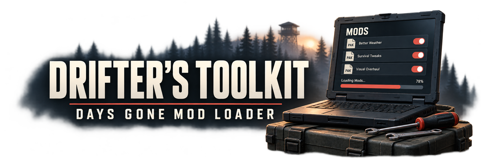
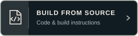
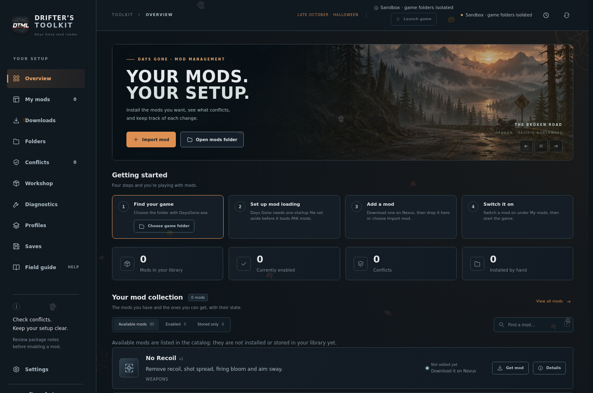

<p align="center">
  
</p>

<h1 align="center">Drifter’s Toolkit Mod Loader</h1>

<p align="center">
  <strong>Days Gone mod management for Windows and Linux.</strong><br>
  Less time sorting out your PAK folder. More time on the Broken Road.
</p>

<p align="center">
  <a href="https://github.com/NeTriXoN-BoT/drifters-toolkit/releases/latest/download/Drifters-Toolkit-Windows.zip"></a>
  <a href="https://github.com/NeTriXoN-BoT/drifters-toolkit/releases/latest/download/Drifters-Toolkit-Linux.zip"></a>
  <a href="BUILDING.md"></a>
</p>

<p align="center">
  <a href="https://github.com/NeTriXoN-BoT/drifters-toolkit/releases/latest">Release notes &amp; checksums</a> ·
  <a href="https://www.nexusmods.com/daysgone/mods/1022?tab=files">Nexus Mods download</a> ·
  <a href="docs/USER_GUIDE.md">User guide</a> ·
  <a href="https://github.com/NeTriXoN-BoT/drifters-toolkit/issues/new/choose">Report a problem</a>
</p>

Drifter’s Toolkit grew out of helping people install my Days Gone mods: the wrong folder, an old version still enabled, or two apparently unrelated mods replacing the same asset. It brings those checks and the everyday file management into one place, including supported PAK mods from other authors.

**Current release: 1.0.9 · Local Edition.** Download mods from their original pages and import them. Nexus API sign-in, version checks and downloads inside the toolkit remain disabled pending approval and live testing.

The Windows and Linux ZIPs are ready to run. GitHub’s **Source code** archives are for building the project; you do not need them to use the toolkit.

## Inside the loader

<p align="center">
  <a href="assets/screenshots/overview.png"></a><br>
  <sub>Overview preview with the updated DTML branding, shown in Linux sandbox mode. Windows uses the same layout. Click the picture for a closer look.</sub>
</p>


## Get on the road

1. Choose the **Windows** or **Linux** download above, or use the [Nexus Files page](https://www.nexusmods.com/daysgone/mods/1022?tab=files).
2. Extract the complete package to a local folder and keep its files together.
3. Open the launcher for your system. Follow the Overview checklist to select the game and prepare mod loading.
4. Close Days Gone, then drop a downloaded PAK or supported mod archive onto the window. Review the selected files and conflicts before enabling them.

| | Windows | Linux |
| --- | --- | --- |
| **Start here** | `DriftersToolkit.exe` | `Launch-DriftersToolkit.sh` |
| **System** | Windows 10 or 11, x64 | x86-64-v2 CPU, glibc 2.35 or newer |
| **Desktop** | Microsoft Edge WebView2 Runtime | Compatible desktop and Chromium sandbox support |
| **Package** | Native Windows application | AppImage with Qt and Chromium libraries included |

Linux supports X11 and Wayland on tested configurations and detects Steam and Proton paths. Extract with an archive tool that preserves executable permissions. Users do not need Docker.

One selected PAK enables after import when the checks allow it. Several selected PAKs remain **Stored only** until you choose what to use. The Field guide and Diagnostics pages help with setup, requirements and recovery.

## Your setup, from download to game

| In the toolkit | What you can do |
| --- | --- |
| **My mods** | Import supported archives or loose PAKs, enable and disable packages, review replacements and manage hand-installed PAKs. Keep inactive packages in your local library. Third-party mods keep their original authorship and download pages. |
| **Conflicts & Profiles** | Check actual package paths for shared assets, review conflict groups and launch saved PAK collections. A profile session restores the previous setup after the game closes, with recovery records if something changes unexpectedly. |
| **Saves** | Browse current saves and supported pictures, keep dated backups, import or export an individual slot and review restores. Supported saves allow skill-point editing; protected and unknown records remain read-only. Optional advanced fields are marked separately and their in-game effects are unverified. |
| **Workshop** | Inspect local PAKs, manage draft files, edit supported cooked properties and review supported combinations against matching original assets. Export a separate package or save the project to continue later. |
| **Diagnostics & Field guide** | Diagnose folder and package problems, review crash summaries, narrow down a troublesome managed mod and export a report for review before sharing. |
| **Settings** | Adjust themes, motion, interface size and text size to suit your screen. Move the toolkit’s data to another drive when you need the space. |


## Know what a check covers

**Compatibility.** An overlapping asset is a reason to review a combination. A clear file scan cannot prove gameplay compatibility. Unreadable and unsupported packages remain unknown.

**Profiles and native plugins.** Profiles swap **PAK files**. Saves are shared between profiles; ASI/DLL plugins, injectors and their dependencies stay outside PAK management and conflict checks. Follow each mod author’s setup instructions.

**Editing and combining.** Workshop works with supported formats and verified properties. It does not automatically merge arbitrary meshes, Blueprint instructions or unknown binary layouts. Test exported packages in game and respect the original authors’ permissions before sharing a combination.

## Prefer a terminal?

The optional CLI supports local package management, profiles, diagnostics, Workshop and supported save workflows. Start with:

**Windows**

```powershell
.\DriftersToolkitCLI.exe --help
```

**Linux**

```sh
./Launch-DriftersToolkit.sh --cli --help
```

Write commands require `--yes`. A profile launch keeps the terminal attached until the game closes and the original PAKs are restored. See the [CLI guide](docs/CLI.md) for examples and recovery commands.

## Find your way around the project

| You want to… | Go here |
| --- | --- |
| Install, use or troubleshoot the toolkit | [User guide](docs/USER_GUIDE.md) |
| Build your own copy | [Build instructions](BUILDING.md) |
| Understand how the code fits together | [Architecture](docs/ARCHITECTURE.md) |
| Report a bug, suggest an improvement or contribute a fix | [Contributing](CONTRIBUTING.md) |
| Report a security problem privately | [Security policy](SECURITY.md) |
| Check licences and component source requirements | [Licensing](docs/LICENSING.md) · [Third-party components](THIRD_PARTY.md) |

The project’s original code is available under the [MIT licence](LICENSE). Bundled and adapted third-party components retain their own licences and notices. The separate save decoder and Linux runtime libraries have their own source and licence requirements; matching source downloads accompany the [release](https://github.com/NeTriXoN-BoT/drifters-toolkit/releases/latest). GitHub’s automatic source ZIP does not replace the Linux corresponding-source bundle. Game files and other authors’ mods are not included.

This is a vibe-coded hobby project. Reports, fixes and careful testing are welcome.

<p align="center">
  <br>
  An independent community tool by <strong>OkayDude1337</strong>.<br>
  Not affiliated with Nexus Mods, Bend Studio or Sony.
</p>
